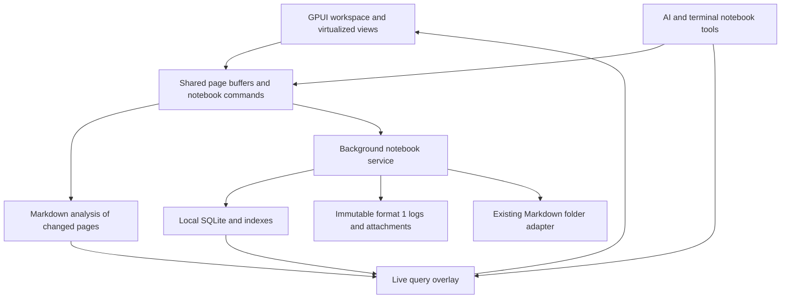

# Native Quire rewrite

Date: 2026-10-29. Status: implementation underway; GPUI foundation and the reference protocol oracle are present. See task proof notes for remaining acceptance.

Audience: Umer and the agent implementing the rewrite. Read this with the existing Quire workflows in mind; prior knowledge of Zed internals is unnecessary.
Outcome: understand what to copy, what to port, how to preserve notebooks, and what evidence is required before replacing the current app.

## Goal

Build a standalone native Quire in this repository, `/Users/umer/code/quire`, using Rust and Zed's GPUI, text engine, editor, Vim implementation, and useful UI components. Umer confirmed this destination. `../rt` supplies Quire's behavior and storage contracts; `../zed` supplies implementation code. Neither sibling repository may be required to build or run the finished application.

Quire's difficult features are shared editable block embeds, Markdown presentation, durable local edits, and notebook queries over a large graph. A faster renderer alone does not solve all four. This plan recommends copying a pinned Zed foundation, adapting its editor to Quire, and porting the current storage work into a native service that loads page text on demand.

The first milestone is a working native editor that proves Write, Source, Vim, shared embeds, and Arabic/Urdu input. The next is a complete edit, save, restart, and sync path. Feature work follows those proofs. Performance and parity are release gates throughout, not work left until the end.

## Scope and defaults

Preserve the features in [the parity ledger](native-parity.md), including existing Markdown folder notebooks, the new Quire notebook format, imports/exports, backups, profiles, AI commands, and terminal notebook tools. The visual design can evolve while retaining the familiar actions, shortcuts, and data semantics.

Start on macOS, where this inspection ran. Windows is part of release parity because the current app targets it. Bring up Linux early and include its native input/rendering smoke checks before declaring the rewrite complete. Detailed Linux packaging is a proposed addition, not evidence of existing support. Browser preview is a development convenience; a browser edition, mobile app, IDE features, hosted sync, and simultaneous collaborative editing are outside this rewrite.

Retain current limitations unless a task explicitly changes them. In particular, do not invent a general page-delete UI, recurring tasks, arbitrary Roam script execution, or cross-file undo. New storage internals are authorized; silently dropping folder-notebook workflows is not assumed.

## Current code map and evidence

The source app is Electron, React, TypeScript, CodeMirror 6, and SQLite. Inspection began at `rt` commit `67728e5e6215`; the working agent committed the coalescing/import changes at `42fe760f8d70c75f4a659ec761d0595094a84b07`, then released 0.9.43 at `e6583d2a3e6657aafe80400deec2f865d77fa424`. The final observed checkout was clean. Use that release as the planning baseline and recheck for later changes at implementation handoff.

Zed was clean at `025d2a06ee7920777bf4947f11e46a1f52e62cbb`. Its checked-in toolchain specifies Rust 1.98.1 and edition 2024. Pin a coherent source snapshot, toolchain, lockfile, features, and required patches when implementation begins.

| Source | What it establishes |
| --- | --- |
| [Quire README](../../rt/README.md), [domain vocabulary](../../rt/CONTEXT.md) | User behavior; note that the vocabulary still primarily describes folder notebooks |
| [Active storage plan](../../rt/plans/storage-engine.md), [storage inventory](../../rt/plans/storage-engine-inventory.md) | New notebook format, reported measurements, task status, and known verification gaps |
| [Notebook store](../../rt/src/core/store.ts), [desktop contracts](../../rt/src/core/types.ts) | Shared buffers, edits, queries, recovery, history, and renderer services |
| [Editor](../../rt/src/editor/Editor.tsx), [block commands](../../rt/src/editor/block-commands.ts), [Vim bindings](../../rt/src/editor/vim-bindings.ts) | Editing behavior that must survive replacing CodeMirror |
| [Markdown model](../../rt/src/core/markdown.ts), [page analysis](../../rt/src/core/page-analysis.ts) | IDs, source ranges, parsing, links, and derived data |
| [Sync codec](../../rt/src/desktop/sync/format.ts), [replica](../../rt/src/desktop/sync/replica.ts), [SQLite store](../../rt/src/desktop/engine/sqlite-store.ts) | Actual format and save/publish behavior, including recent unpublished-save coalescing |
| [Folder storage](../../rt/src/desktop/vault.ts), [backups](../../rt/src/desktop/backups.ts), [engine restore](../../rt/src/desktop/engine/backup.ts) | Legacy notebooks, recovery, relocation, and restore semantics |
| [AI runner](../../rt/src/desktop/ai-runner.ts), [notebook tools](../../rt/src/core/notebook-tools.ts), [bridge](../../rt/src/desktop/notebook-bridge.ts) | CLI invocation, proposal review, live notebook access, and terminal integration |
| [Zed display map](../../zed/crates/editor/src/display_map.rs), [multi-buffer](../../zed/crates/multi_buffer/src/multi_buffer.rs), [text](../../zed/crates/text/src/text.rs) | Incremental display transformations, editable excerpts, anchors, and text history |

### Incorporate the active storage work

The current storage plan already proposes the right broad separation: a local database outside cloud folders, and immutable change files for transport. Port its tested format and semantics rather than designing a second sync protocol during the UI rewrite.

| Work in `rt` | Evidence at inspection | Treatment here |
| --- | --- | --- |
| Tasks 2 through 5: codec, sync harness, engine, desktop wiring | Marked done, with code and recorded tests | Import fixtures and port behavior; rerun compatibility tests in Rust |
| Task 6: engine queries and lazy page loading | Still `in_progress`; proof notes explicitly say all-page delivery remains | Mandatory native work, even if the other agent leaves it unfinished |
| Task 7: cloud providers and Git | Plan says pending; commit `67728e5e6215` implements new-engine Git sync | Inspect finished code and tests; real provider verification and growth measurement remain separate gates |
| Task 8: backup and restore | Marked done, but proof notes name full-disk, Roam export, and whole-notebook Markdown export gaps | Carry those gaps into this queue; do not treat the status label as proof |
| Task 9: import/release | Plan says pending; commit `42fe760f8d70` adds Markdown folder import | Reconcile final import targets, experimental/default status, docs, and package tests |
| Unpublished-save replacement | Newly committed in `sync/replica.ts` | Freeze the final rules for replacing autosaves, uncertain publish, crash adoption, and retained history |

Before copying behavior, confirm the handoff source commit and record any later worktree changes. Reconcile code, tests, README, CONTEXT, and plan proof notes. Independent GPUI experiments can proceed using synthetic data. Do not modify the other agent's checkout or wait indefinitely for every future `rt` improvement. The clean 0.9.43 release does not close the documented storage-plan gaps.

One contract needs correction in this rewrite: the local database is not always disposable. It contains the only copy of unpublished saves and recovery drafts. Rebuilding solely from published logs is safe only after proving those local records are empty or preserving them separately. Likewise, coalescing autosaves means an old acknowledged intermediate revision may no longer exist by its original ID. Test survival of the latest acknowledged content and the agreed history policy, not an obsolete assertion that every intermediate autosave ID lives forever.

## Reuse strategy

### Copy a coherent Zed foundation

Vendor selected sources under `vendor/zed/`, with their notices, tests, resources, shaders, build scripts, grammar inputs, and required supporting crates. Maintain an upstream revision and a per-component modification record. Use real copied files, not a submodule, symlinks into siblings, or a Cargo Git dependency on `zed-industries/zed`. Rewrite workspace paths so they remain within `quire`. Keep ordinary third-party dependencies pinned in Cargo; the requirement is independence from a Zed checkout, not a new requirement to vendor every registry package.

Quire uses a separate namespaced copy of the pinned Markdown grammar under `vendor/quire-markdown`. Its scanner disables setext headings and tables that interrupt paragraphs, matching the frozen Quire dialect. Its generated declaration rule closes HTML declarations before following paragraphs. Copied Zed components retain the upstream grammar. Both use the existing pinned tree-sitter runtime; the copy needs no sibling checkout at build time. Source provenance and modifications are recorded in its `UPSTREAM.json`.

| Zed component | Use in Quire | Boundary or qualification |
| --- | --- | --- |
| `gpui`, `gpui_platform`, native backends, macros, scheduler, supporting crates | Windowing, GPU rendering, events, layout, async tasks, text services, tests | Copy the platform closure, including resources. On this snapshot macOS needs `font-kit`; Linux needs a windowing backend |
| `sum_tree`, `rope`, `text`, `clock` | Efficient text storage, stable edit anchors, snapshots, undo primitives | Internal editor data structures; Quire's revision log remains the persistence protocol |
| `language`, `multi_buffer` | Syntax-aware buffers and editable excerpts of shared pages | Begin with Markdown and required code grammars; avoid activating language servers or project scanning |
| `editor`, display maps, custom blocks, folds, selections | Source editor and foundation of Write presentation | Adapt an embedded editor first; retain proven cursor/selection/IME machinery |
| `vim`, actions, editor key handling | Modal editing and operators | Add Quire's outline/task/template/AI semantics; Zed defaults are not exact Quire parity |
| `ui`, theme, menus, picker/fuzzy helpers | Controls, command palette, lists, dialogs, theme plumbing | Use Quire assets, typography, navigation, and preferences |
| `sqlez` and selected helpers | SQLite connection/worker primitives | Give Quire its own schema, connection policy, error handling, backup behavior, and bounded work queue |
| Test contexts and selected editor/Vim tests | Native regression infrastructure | Copy useful tests with the implementation; add Quire-specific contracts |

Do not start by copying the Zed executable, account flows, telemetry initialization, collaboration service, project shell, debugger, terminal, or AI product. Supporting types may be needed to host its editor; distinguish a compile-time dependency from an activated runtime service.

A static manifest traversal at the pinned checkout found 22 local crates reachable from `gpui_platform`, 53 from `multi_buffer`, 102 from `editor`, and 108 from `vim`. These counts include the starting crate, optional dependencies, and all target-specific normal/build dependencies. They exclude dev dependencies and do not resolve Cargo features. They measure coupling, not shipped size or runtime cost.

Therefore, first get the copied editor working with its required supporting crates and inert IDE services. Then remove or isolate dependencies that prevent standalone operation, complicate maintenance, or show measured costs. Do not rewrite selection, undo, shaping, or Vim merely to hit an arbitrary crate-count target. A narrow host interface is justified only where the integration exposes a real dependency.

The early editor gate decides whether Write can use the copied display map with a small notebook presentation layer. If it cannot, record the failing interaction and implement the missing mapping in the fork. A custom GPUI editor over `text` is a fallback requiring new estimates and equivalent selection/Vim/input tests, not the default shortcut.

### Licenses and maintenance

GPUI and its platform manifests use Apache-2.0. The selected editor, Vim, text, rope, UI, and SQLite helper crates use GPL-3.0-or-later. Plan the copied application accordingly, retain notices, and provide the required corresponding source if distributing a GPL-covered build. No publication is part of this planning task. [GPUI manifest](https://raw.githubusercontent.com/zed-industries/zed/main/crates/gpui/Cargo.toml), [editor manifest](https://raw.githubusercontent.com/zed-industries/zed/main/crates/editor/Cargo.toml), [Zed GPL terms](https://github.com/zed-industries/zed/blob/main/LICENSE-GPL).

The fork becomes Quire's maintenance responsibility. Keep upstream-derived code recognizable, record local changes, and bring in selected fixes through tests. No automatic tracking of Zed main. Do not bundle the user's commercial Pragmata font; preserve installed-font detection and package licensed fallback fonts with their notices.

## Interfaces and contracts

### Native application structure

Start with three application crates, splitting further only when a boundary warrants it:

```text
crates/quire/          GPUI app, workspace, notebook editor, AI process/MCP host
crates/quire_core/     Markdown semantics, tasks, templates, import/export models
crates/quire_store/    SQLite, revision codec, sync, folder adapter, queries, backups
vendor/zed/           copied foundation and required supporting crates
tests/fixtures/       synthetic notebooks, protocol vectors, behavior transcripts
tests/native/         input, rendering, packaged-app and process-failure tests
tools/                fixture, benchmark, dependency and compatibility runners
```

The UI owns one shared buffer per `(notebook_id, page_id)`. Source, Write, splits, zoomed blocks, and embeds are views of that buffer. Store work runs outside the GPUI foreground thread and returns versioned results. There is no full-notebook text snapshot delivered at startup.



Define typed internal operations for opening a notebook/page, reading a bounded query page, applying an edit transaction, recording recovery, committing, resolving a conflict, and subscribing to changes. Commands carry notebook identity, page identity, expected revision/buffer version, and a request ID. Query responses carry a notebook generation and continuation cursor. Discard results from an earlier query or switched notebook.

Keep behavior compatible with `NotebookAPI`/`DesktopAPI`; do not preserve Electron IPC or synchronous all-page method signatures merely for resemblance. AI tools and UI queries share the native notebook service. Keep externally consumed MCP tool names and schemas compatible unless versioned deliberately.

### Editing and display

Use Markdown source as the page's textual representation. Retain existing `^block-id` identities and imported Roam identifiers. Do not store rich text as a second editable document, regenerate IDs on every parse, or normalize saved content merely to simplify rendering.

Write is a projection over the same buffer as Source. Hidden bullets/IDs, rendered links, checkboxes, headings, code, media, and nested excerpts need explicit mappings from display positions to source positions. Folding and decorations must not introduce source edits. Existing setext-heading suppression and structural editing rules are compatibility requirements.

Use Zed anchors for ranges that must survive edits. At fixture and tool boundaries, explicitly translate JavaScript UTF-16 offsets to Rust byte offsets and editor coordinates. Test surrogate pairs, combining characters, Arabic diacritics, Urdu shaping, mixed direction text, tabs, CRLF, and grapheme deletion. Visual cursor movement and logical text order are distinct concerns.

An editable embed owns a view and an anchored subtree range, never a copy of the source text. Edits and undo route to the source buffer. Changing its parent or children updates its range. Selection, paste, AI transforms, and Vim commands cannot escape the allowed subtree. Detect cyclic embeds and bound depth and mounted views while keeping a path to reveal the source.

Multi-buffer excerpts are a promising implementation mechanism, not proof that these semantics already work. Test undo from either of two views, switching Write/Source, editing two occurrences of one block, hidden syntax, and subtree boundaries before building the rest of the UI.

### Storage and synchronization

The default new notebook uses the finished `rt` format 1 protocol: per-device immutable `.qlog.zst` files, content-named attachments, local SQLite in the native app's own data directory, and explicit conflict heads. Preserve page IDs, revision IDs, unknown fields, sequence chains, conflict rules, and settings records. Zed's internal text operations do not replace this protocol.

Build compatibility vectors for exact canonical JSON, including JavaScript UTF-16 key sorting, string escaping, JavaScript number behavior, parent sorting, Unicode path normalization/lowercasing, and hashing uncompressed bytes. Do not substitute Rust byte ordering or Unicode case folding without checking equivalence. Compression output need not be byte-identical when decompressed canonical content and hashes match. Read the actual codec, not only its prose description. Include decompression limits, newer formats, duplicate delivery, gaps, missing parents, conflict copies, corrupt files, and copied device identities.

Use SQLite WAL with `synchronous=FULL` for every connection that writes authoritative notebook data. Validate the effective pragmas and FTS support in tests. Zed's `db` application layer currently selects `synchronous=NORMAL` and can fall back to memory; neither policy is suitable for Quire's saved indicator. Reuse `sqlez` primitives with a Quire policy rather than that layer. SQLite documents the durability distinction and WAL's same-host requirement. [SQLite WAL](https://sqlite.org/wal.html).

The acknowledged save transaction includes the revision or coalesced successor, page heads, outbox, and the appropriate recovery transition. Attachments must have a durable local copy before acknowledging edits that depend on them. A failed cloud-folder write must leave that copy and pending publication retryable. Serialize save/coalescing with publication snapshots: once a revision is selected for an in-flight batch, replacing it cannot race the file write. Import advances data and its cursor together. Publishing keeps the established fsync, immutable rename, and crash-adoption rules, with platform-specific implementations tested on Windows too.

The database holds authoritative local work until publication and separate recoverable drafts afterward. Derived indexes can always be rebuilt; unpublished data cannot. A damaged or newer database must be preserved for recovery, not silently replaced after telling the user everything was recovered. Offer an actionable failure or recovery path. Never report a memory-only save as durable.

Keep separate states for edited in memory, recorded for recovery, saved locally, published to the provider folder, successful Git push, and verified backup. Provider-folder publication does not prove OneDrive/Dropbox delivery or that another device applied a change. Quit first secures local work, then attempts publication; if publication fails, show the pending work and a retry or explicit quit-with-local-copy choice instead of hanging or losing it.

Keep local multi-page operations atomic. Format 1 may deliver revisions across more than one batch, so do not promise remote multi-page atomic visibility without a protocol proof. Require convergence and no content loss; any stronger cross-device transaction contract needs a separately compatible design.

### Queries and bounded memory

Store page metadata, blocks, references, backlinks, tags, tasks, project membership, dates, templates, and search indexes in SQLite. Update analysis for changed pages. Cache by page revision and parser/schema version. Use FTS5 for words and substrings, preserving current ranking and short-query behavior; trigram search alone does not cover every short query. [SQLite FTS5](https://sqlite.org/fts5.html).

Load text for active pages, visible embeds, requested tool results, and a bounded recent-page cache. Pin dirty buffers until recovery/save is durable. Bound parsed trees, undo retention, query results, media textures, and embed views by a configurable memory budget. Evicting a clean buffer must have a defined undo policy; do not silently break undo when a tab closes. Start by preserving session undo for visited pages, then measure its cost before imposing a cap visible to users.

Queries merge indexed committed rows with an analysis overlay for unsaved/open-page changes. Remove the old contribution for each overlaid page before inserting its current contribution, then filter, rank, and page results. This avoids duplicate or stale tasks and ensures UI and AI see the same edits. Track index generations so delayed parsing cannot replace a newer edit. Never solve live-query correctness by loading every page into the UI.

Existing folder notebooks use a compatibility adapter with watched ordinary Markdown files, compare-before-write, durable recovery/history, attachment boundaries, and journaled relocation. They share commands and query infrastructure with Quire notebooks. Opening a folder does not convert it. A separate copy/import operation can create a format 1 notebook and report what was preserved.

### Features requiring separate native work

Port Quire's Markdown semantics and tests; a stock CommonMark or tree-sitter parser is not automatically equivalent to its Lezer configuration. Preserve list boundaries, task stamps, namespaces, tags, templates, link resolution, and import metadata through differential fixtures.

GPUI does not supply Chromium's PDF viewer, CSS text behavior, or Prettier. Prove inline PDF display and the seven currently supported formatting languages early. Prefer a pinned cross-platform PDF renderer with bounded page textures and an Open PDF fallback. Select its library after a native packaging spike. A development subprocess can supply an oracle, but the delivered app must not unexpectedly need Node/Bun for its normal editor features. A required helper must be packaged and tested explicitly.

Port CLI-backed AI behavior into the native process host: streamed proposals, accept/reject/undo, stale-target checks, Tidy restrictions, synthesis, cancellation, export, and private transcripts. Preserve Off/Review/Apply semantics. A Rust stdio MCP mode or companion executable can replace the Electron Node-mode server while retaining the token-checked local bridge. It answers through the live notebook service, including unsaved buffers. Keep existing backend isolation guarantees and their documented limits; do not equate a read-only CLI sandbox with inability to read other files.

## Performance contract

The following old measurements come from the source plan, not new tests run here. On its reported Apple-silicon machine, 6,536 pages/120,239 blocks occupied 13.0 MB of source; 32,680 pages/604,736 blocks occupied 65.6 MB. Folder-engine warm first paint was 687 ms and 1,603 ms. The experimental engine reported 643 ms and 1,785 ms. At 5x, the source plan attributes about 800 ms to delivering 114 MB to the renderer. These figures motivate lazy loading but do not measure first editable state or native performance.

Proposed release budgets below are engineering targets, not measured results. Freeze hardware, OS, display refresh rate, font set, power state, fixture seed, and build profile in task NR01. Change a missed budget only through an explicit recorded tradeoff, not by relabeling the endpoint.

| Measure | Proposed acceptance on local SSD, release build |
| --- | --- |
| Warm launch to visible, focused, editable restored page | p95 <= 750 ms on both 1x and 5x corpora |
| Cold app launch with an existing local database | p95 <= 1.5 s at 1x; <= 2 s at 5x |
| Open page, backlinks, tags, or task view | p95 <= 50 ms for the first correct viewport |
| Full-text search | p95 <= 100 ms for first results, including live overlay |
| Typing foreground CPU work | p95 <= 4 ms, p99 <= 8 ms in the workload below |
| Input event to presented frame | p95 <= 2 refresh intervals; report actual milliseconds and refresh rate |
| Scroll frames | p95 within one refresh interval; fewer than 1% over two intervals |
| Durable save acknowledgment, ordinary page | p95 <= 50 ms after dispatch; report debounce separately |
| Ready-process memory, 5x with fixed open views | Target <= 250 MiB resident memory; report GPU/media allocations separately |
| Scale sensitivity, 1x to 5x with fixed views | Warm startup <= 1.25x; resident-memory growth <= 50 MiB |
| Correctness under load/failure | Zero lost latest-acknowledged edits, silent conflicts, or stale accepted writes |

Use the existing synthetic generator plus purpose-built fixtures: a large outline, a 1 MiB page, 100 embed references with only a viewport mounted, dense tasks/links, missing attachments, large PDFs, and English/Arabic/Urdu text. Specify ordinary-page save fixtures separately from the 1 MiB stress case. Measure typing during search, import, sync, background indexing, and backup. Count loaded page bodies and mounted views to verify bounded work even when timing varies.

Run at least 30 launches per reported configuration and enough interactions for percentiles, with a fixed warm-up policy. Record distributions and raw JSON, not only medians. Cold OS-cache tests and first-time log replay are distinct experiments. Measure rebuild time, index completion, disk growth, and a synthetic year of sync history separately; do not hide them inside a warm-launch number. Report process RSS, not just managed heap, and record all helper processes.

Native event-to-frame measurement is not a claim about physical key-to-photon latency. Use external measurement if that claim becomes necessary. CI runs deterministic correctness and work-count gates everywhere; timing gates run on controlled desktop runners. Automated process-kill tests do not prove power-loss behavior.

## Implementation strategy and verification

The authoritative [task queue](native-rewrite-tasks.md) gives dependencies, write sets, acceptance criteria, and proof slots. The [parity ledger](native-parity.md) maps current behavior to source tests and native ownership. All implementation tasks are pending.

1. Freeze source behavior and prove standalone GPUI, editor/Vim, Write/embed mapping, typography/input, PDF, and formatting feasibility.
2. Port format 1 and durable saves, then run mixed TypeScript/Rust replicas through shared schedules. Integrate one daily-page edit/save/restart path.
3. Complete indexed queries and folder compatibility, then ship vertical slices for blocks, references, navigation, tags, tasks, templates, and media.
4. Port data exchange, history, backup/restore, provider sync, AI/tool integrations, help, and workspace settings.
5. Run complete parity, performance, native OS, migration, and packaged-app acceptance before cutover.

Copy useful source fixtures and expected outputs into this repo. Differential testing can use a pinned, copied TypeScript reference runner in development, with its dependency lock and no imports from `../rt`. Regenerate expectations only after investigating a semantic difference. Existing DOM and Playwright tests are evidence about behavior; they cannot execute against GPUI unchanged.

New verification commands must be implemented by the relevant tasks. The intended gate groups are `cargo test --workspace --locked`, scoped formatter/clippy checks, protocol/parity fixtures, mixed-replica schedules, process-failure tests, native input/rendering checks, and release benchmarks. Do not claim those commands pass before the workspace exists. Keep vendored upstream lint scope explicit rather than globally suppressing failures.

Before each phase is called complete, review the implementation against the task, parity rows, and proof output from a fresh reading. An independent reviewer is preferable when available; a sequential review must be labeled as such. Reopen gaps. Screenshots alone do not prove selection, IME, shared undo, persistence, or accessibility.

## Rollout and rollback

Development builds use a separate application identity and app-data root. They operate on synthetic notebooks and explicit copies. Use a distinct device identity for the native replica; never copy the old writer's device ID. Add locking that prevents concurrent access to one local database. Do not imply two applications can safely write one legacy folder just because their app-data roots differ.

For format 1 notebooks, first open a copied sync folder read-only, verify all hashes/heads, then enable writes in the copy. Compare Rust and TypeScript replicas both ways before any real shared folder trial. Preserve the old local database and migrate its unpublished work and recovery through a documented export/import or offline snapshot path. Published logs alone do not transfer local-only work.

For folder notebooks, support direct open through the compatibility adapter. Conversion into a new Quire notebook is explicit, restartable, and leaves the source unchanged. Report page/block/attachment counts, hashes, unresolved references, metadata, recovery, and retained history. Plain Markdown import may lack history; offer full-state migration or disclose that limitation before a user chooses conversion. Do not silently call a content-only import a full migration.

Backup/restore preserves hidden metadata and source archives as well as text and attachments. Restoring format 1 creates a new notebook identity and rewrites notebook-scoped batches consistently while preserving page/revision IDs. Test recovery drafts and attachments with no current text reference. Whole-notebook Markdown and Roam exports are escape paths; Markdown alone does not preserve all history or metadata.

Run native and legacy apps side by side on separate notebook copies until the parity ledger and performance gates pass. Revert by reopening the untouched old notebook or a verified backup. Edits made after cutover must be exported or replayed back through a proven compatible path before reverting. Do not delete old data automatically.

Cutover requires all parity rows to have evidence, fresh performance runs, source-independent clean builds, native macOS/Windows acceptance, Linux smoke results, provider tests, and a demonstrated restore. If provider or OS hardware is unavailable, record that gate as unverified and keep the build experimental. Do not infer delivery across machines from one shared local directory test.

## Alternatives and remaining decisions

**A whole Zed application fork** gives more immediate UI infrastructure but brings its project-centric product and lifecycle. Copy the editor's working dependency closure first; add larger pieces only when their saved implementation effort outweighs measured integration cost.

**GPUI plus a new editor from scratch** gives control but duplicates years of selection, shaping, undo, and Vim work. Keep it as a documented fallback if the projection/input spike demonstrates a blocker.

**Electron with the new engine** remains a useful behavioral and performance baseline. It does not satisfy this native rewrite. **A block database with a new sync algorithm** would add conversion and conflict risks before proving that format 1 is the bottleneck. Start with indexed Markdown revisions and improve measured hot paths.

The early tasks must settle the editor host boundary, bidi/IME gaps on each platform, PDF implementation, formatter packaging, final `rt` sync/coalescing semantics, and index consistency under live edits. Those are measured decisions. Platform priority, exact budgets, and retaining folder mode are stated defaults that can be revised explicitly. Public distribution licensing and signing are handled before distribution, not by blocking a private prototype.

## Planning proof notes

This session inspected the current source, active plan and inventory, relevant tests, Zed manifests/display maps/buffers/SQLite helpers, and official GPUI/SQLite/license references. The dependency counts came from a read-only TOML traversal, not a resolved Cargo build. No native prototype was built and no runtime performance was measured. Source test results quoted above are attributed to the existing plan and were not rerun against the other agent's moving worktree.

The plan's highest-risk assumptions are explicitly gated before broad feature work. Planning verification passed: prose lint on all four Markdown files, local Markdown links, all 37 task schemas/dependencies, all 47 source-inventory rows plus 16 additional parity rows, balanced code fences, whitespace checks, and read-TODO coverage. A sequential completion review tightened the independence requirement, canonical key ordering, and save-versus-publish concurrency contract. This was not an independent agent review. Implementation proof belongs in the task queue as each task runs.
